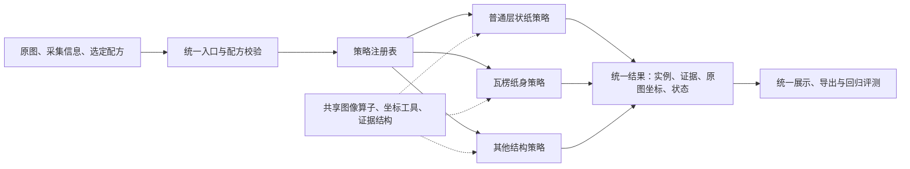

# 按纸张结构组织检测策略的架构设计

设计日期：2026-11-15。第一轮迁移日期：2026-11-16。
统一调度、策略注册、分组参数、配方重放和实例输出已实现；具体用法见 [迁移说明](PIPELINES.md)。
下文仍包含后续目标：旧数值配置/结果适配器暂时保留，自动选型和新的成像拒绝政策尚未启用。

目标是让每类纸有明确、独立验证的检测方案，同时复用图像处理工具、坐标管理、运行框架和评测能力。
当前 `tracks`、通用 `regions` 和瓦楞纸结果先作为行为基线保留；行为基线不等于真实标注。

## 1. 组织原则

采用“共享工具与数据契约 + 专用检测流水线 + 版本化配方”。

共享的是可靠的计算能力和接口；纸身身份、层间缝隙、合并切分、边缘残片等判定由具体策略负责。
新增一类纸时，主要增加一个策略包、参数定义、配方和回归样例，不修改各处的材料判断分支。

纸类按可观察结构和计数规则分组，例如层间边缘清楚的层状结构、开放瓦楞空腔、压实弱边、复合层纹。
商品名称、厂家、SKU 可以映射到这些结构族，但不直接决定必须复制一套代码。
同一结构族可复用算法并使用不同成像配方；如果纸身身份判据不同，应使用不同策略。



## 2. 共享边界

| 部分 | 可以共用的内容 | 留给策略决定的内容 |
| --- | --- | --- |
| 输入与成像 | 读图、位深、采集元数据、清晰度/饱和度等指标计算 | 各指标的可接受范围，是否需要重拍 |
| 几何处理 | 裁剪、旋转、重采样、仿射/非线性坐标变换 | ROI 提取方式、旋正依据、采样窄区与宽度 |
| 证据提取 | 灰度、梯度、条带、峰谷、连通结构、周期等计算工具 | 使用哪些证据、参数、组合顺序及证据可信条件 |
| 纸身判定 | 有序关联、区间优化等通用求解器 | 什么算一张、内部纹理与层间缝隙如何区分 |
| 验证 | 坐标有效性、变换一致性、标识唯一性等契约检查 | 厚薄异常、残片、合并、切分、物理互斥规则 |
| 输出与评测 | 文件组织、可视化框架、运行记录、指标实现 | 该类纸的评价单位与代表样例 |

ROI 和预处理是检测策略的一部分。共用裁剪算子不表示所有纸都用同一套 ROI 选择规则，
共用对比度算子也不表示必须先对所有图片做相同增强。

共享工具接收明确的数组、坐标和少量参数，不接收包含所有材料开关的总配置。
原始灰度保留为独立证据源，增强图只用于声明过的候选生成步骤；不得混淆两者。

先复用语义一致的实现。一个材料特有的规则先放在策略内，确有多个策略需要时再提取为共享模块。

## 3. 三个独立维度

1. **纸张结构与计数单位**：例如数整块瓦楞纸身，还是数某一种可见边界。一个纸身内的多条亮带不能自动成为多张。
2. **成像配方**：相机、光源、距离、曝光、方向、像素尺度及允许的成像范围。缺少物理标定时保留像素单位，不伪造毫米数值。
3. **检测策略及版本**：该结构、成像条件下采用的证据、关联和验证流程。

材料、成像配方、策略分别命名。改变曝光或拍摄距离不必复制整个材料算法；
改变纸张身份的判据则不能只靠增加几个阈值开关掩盖。

早期通过工单/SKU或人工选择配方。自动选型可以以后增加，但需先检查策略适用条件。
无法确定时返回待复核或不适用，不能通过“哪个结果更接近期望张数”来挑算法，
也不能直接比较不同策略未经校准的 confidence 后选最大者。

## 4. 配方与接口草案

以下是目标结构示意，不是当前版本已支持的 YAML 或 API。

```yaml
schema_version: 1
recipe_id: corrugated_side_v1
material_family: corrugated
count_unit: board
capture_profile: side_camera_a_v1
pipeline: corrugated_body_v1
parameters:
  geometry:
    roi_policy: bright_core_with_dim_edges
    sampling_width_px: 225
  segmentation:
    boundary_policy: measured_transverse_seams
runtime:
  export: compact
```

参数定义由 `CorrugatedParameters` 等策略自己的类型管理；共享运行参数单独管理。
未知字段、错误参数范围、材料与策略不匹配应明确报错。导出完整展开后的配方，而不只保存预设名称。

```python
class DetectionPipeline(Protocol):
    pipeline_id: str

    def run(self, frame: InputFrame, recipe: Recipe,
            trace: RunTrace) -> DetectionResult:
        ...

# 使用显式注册即可，第一阶段不需要动态插件扫描。
PIPELINES = {
    "regions_generic_v1": GenericRegionsPipeline,
    "corrugated_body_v1": CorrugatedBodyPipeline,
    "tracks_existing_v1": ExistingTracksPipeline,
}
```

统一入口负责输入、配方校验、策略创建、结果契约检查和输出。
具体策略控制自己的处理顺序，可以组合共享工具，也可以使用专用证据提取器。
不要求每类纸必须经过相同的增强、条带数量、候选类型和后处理步骤。

例如，瓦楞纸策略可以组合“主体定位 → 几何处理 → 原始灰度/空腔证据 → 纸身分段 → 专用验证”；
轨迹策略可以组合“自己的 ROI 与预处理 → 梯度观测 → 轨迹关联 → 纸张身份验证”。

`tracks`、`regions` 保留为兼容别名和方法族。材料策略是组合方案，轨迹或框是其可以提供的几何证据，
不让业务代码依赖某个历史 `debug_info.algorithm` 字符串来决定整个输出流程。

## 5. 数据契约

| 对象 | 必须表达的信息 |
| --- | --- |
| InputFrame | 原图、图像标识/哈希、采集元数据；原图保持不变 |
| PreparedFrame | 工作图、有效像素范围、原始/增强视图来源、明确的坐标变换链 |
| Evidence | 观测类型、坐标系、来源阶段、实测/推断标识、支持数据与诊断引用 |
| PaperInstance | 纸身标识、计数单位、可用几何、所依据证据、完整/残片/不确定状态、是否计数 |
| DetectionResult | 纸身实例、由实例导出的数量、配方/策略版本、运行状态、警告、诊断引用 |

“观测”与“实例”分开：亮带、梯度峰、空腔、边界和轨迹都是证据；
怎样将这些证据组成一张纸由策略决定。输出轨迹的策略不需要伪造没有观测到的上下边界来凑矩形框。

内部可以使用不同工作坐标系，但每个几何对象必须声明坐标系并携带转换依据。
对外统一提供原图坐标；工作坐标用于诊断。变换链需要支持现有局部切线对齐产生的非线性映射，
不能假设所有变换都能用一个 3×3 矩阵表达。

迁移现有 API 时保留 `detection_x/y` 等旧字段的原有含义，通过新增原图几何字段或接口版本引入新契约，
不能在原字段名下悄悄切换坐标系。

`count` 根据该配方声明的计数实例集合计算，残片和推断实例的处理政策必须显式。
无法检测或成像不合格时，数量可以为空并返回原因，不能伪装成“检测成功、数量为0”。
不同策略的自检分数不视为同一概率尺度。

共用验证检查几何和数据契约。厚度删除、是否允许重叠、是否补层、是否合并属于策略验证。
例如，倾斜或弯曲纸身的轴对齐外接矩形可能重叠，不能将所有外接框重叠都作为通用删除依据。

## 6. 建议目录

```text
paper_counter/                       # 项目目录
  paper_counter/                     # Python 包
    api.py                           # 对外接口与兼容适配
    engine.py                        # 配方加载、策略调度、运行记录
    registry.py
    contracts.py
    shared/
      image_ops.py
      geometry.py
      coordinates.py
      observations.py
      sequence_solvers.py
    pipelines/
      regions_generic/
        pipeline.py
        parameters.py
      corrugated_body/
        pipeline.py
        parameters.py
        preparation.py
        evidence.py
        segmentation.py
        validation.py
      tracks_existing/
        pipeline.py
        parameters.py
    exports/
  recipes/
    capture/
    materials/
  evaluation/
    manifests/
    annotations/
  tests/
    contracts/
    regression/
```

目录按实际代码量拆分，开始时每个策略不必创建所有空文件。
对外保持一个调用入口；新增纸类不复制 CLI、批处理、坐标导出和报告程序。

## 7. 当前项目的迁移顺序

1. **固定现状**：保存当前三个方案的源码/配方快照、代表结果与问题案例；保留现有 API 和命令行行为。
2. **引入契约、配方、注册表**：先包装现有函数成为三个策略，通过适配器维持旧 `PaperCountResult` 和导出协议。
3. **搬出材料分支**：将 `region_counter.py` 的瓦楞分支移到自己的流水线；将共用观测提取和纸身解释分开。
4. **拆分准备策略和配置**：ROI 选择政策由策略持有，纯几何算子共用；逐步拆解总 `CounterConfig`，旧 YAML 经显式适配器继续可用。
5. **再扩展纸类**：为新结构增加策略、参数类型、适用成像条件和代表样例，完成对应回归后注册启用。

当前瓦楞分支之前仍会执行通用候选、单位选择和联合边界处理；
迁移时应明确哪些是瓦楞真正需要的观测，哪些属于原通用策略的语义判断。
不能仅将现有整个函数复制到不同目录后视为完成解耦。

第一轮架构迁移以行为等价为目标，核对数量、几何、坐标和关键证据。
迁移完成后，再单独对算法行为做实验和版本升级，避免把结构重构与效果变化混在一次变更中。

## 8. 泛化验证与实验管理

每个策略声明适用条件、计数单位和小型固定代表集，覆盖本类纸实际遇到的背景、暗边、反光、压实、倾斜和模糊。
在不同拍摄批次、不同纸堆、不同采集条件上分别评估；同一次拍摄的相邻图片不能当作独立的泛化验证批次。

当前没有真实张数/逐层标注时，先验证可以确定的性质：原图不变、坐标可追溯、没有凭厚度生成切点、
外侧残片处理有证据、物理单位不混淆、成像不适用时有明确状态。
原27图的薄片、原47图33/34号框之间的全白区域、55图的空腔与亮筋、18图的主体范围可成为问题回归样例。
历史输出数量只作为行为基线，不自动当作正确张数；有标注后再评价计数、漏检、误检和边界位置。

共享模块变更覆盖受影响的全部策略回归；单个策略变更覆盖该策略和公共契约测试。
新增纸类不以已有其他纸类结果退化为代价。

输出分为实验运行和已验证运行，统一保存输入哈希、完整配方、采集配置、代码版本/源码快照和验证记录。
发布结果通过明确记录指向某个已验证 run，避免多个目录都叫 final。
算法定版后清理实验输出，保留最终结果、关键行为基线、验证记录及报告依赖，避免清理后对比页失效。
